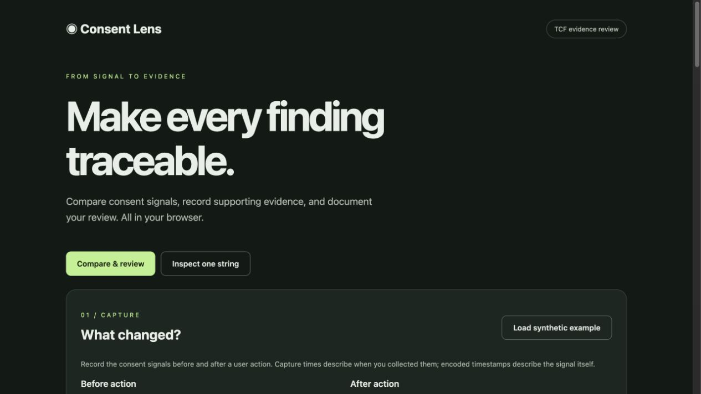
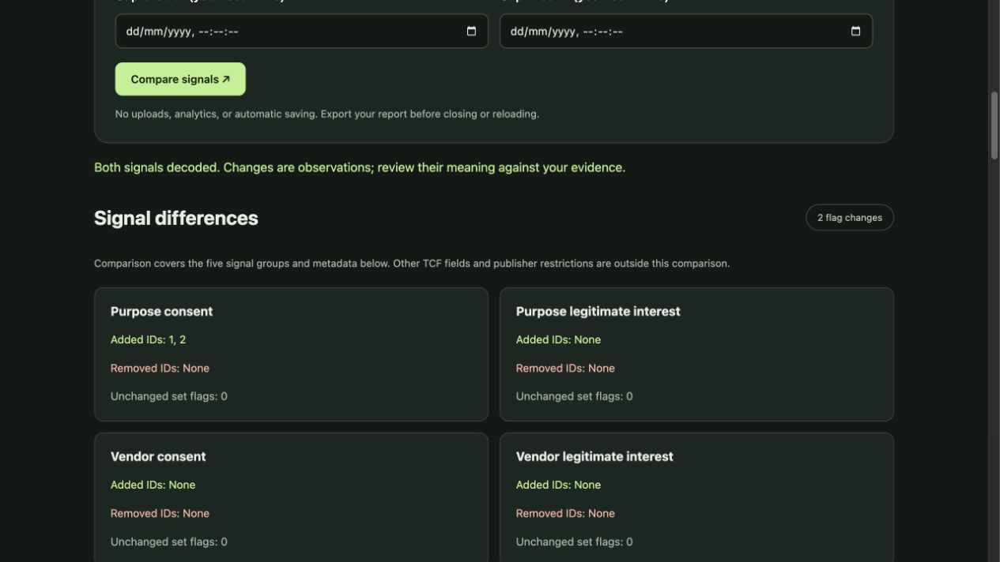
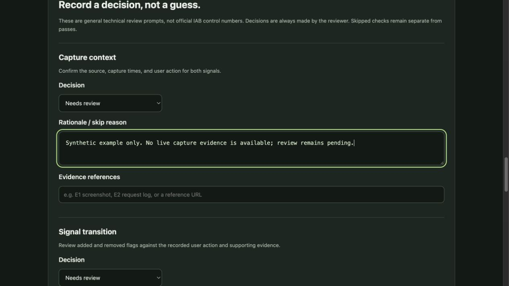
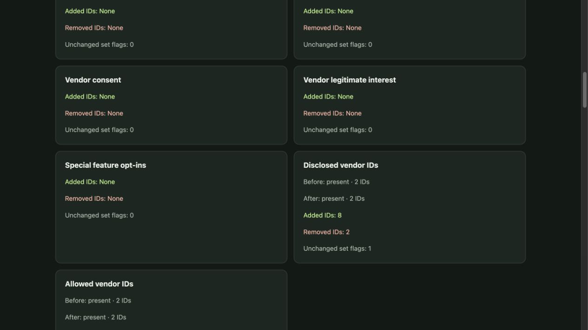
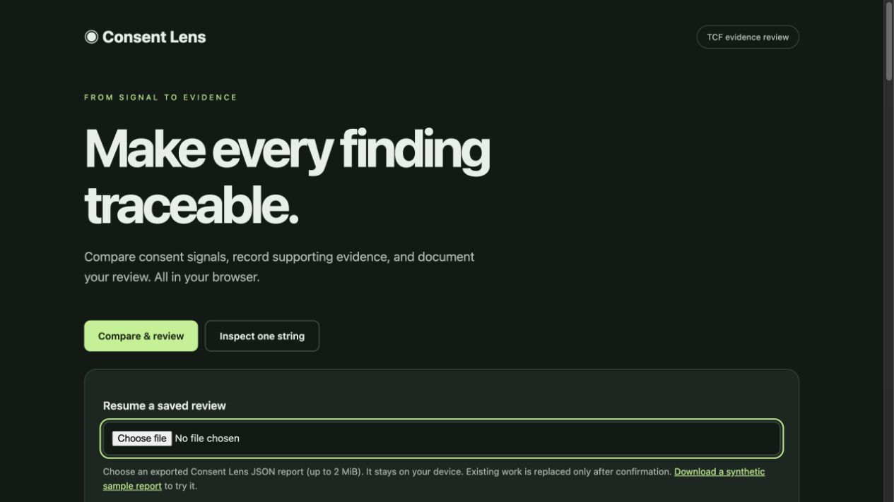
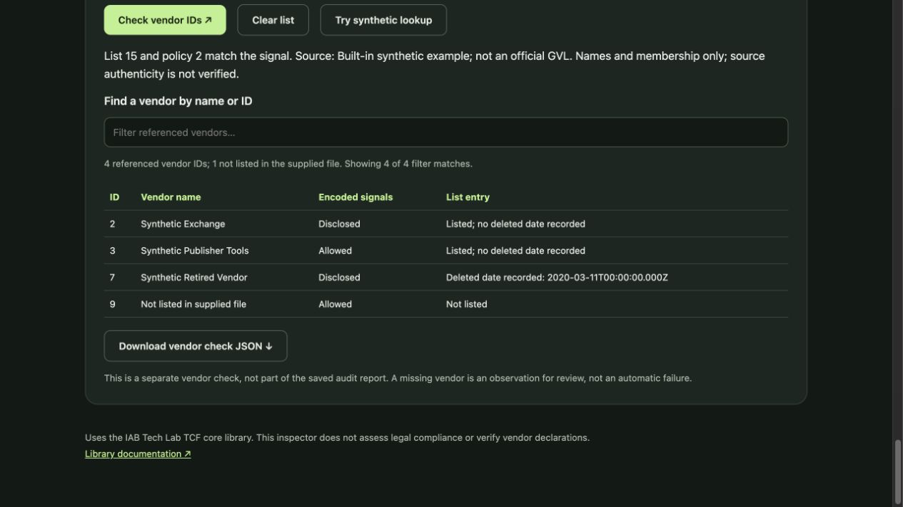

# Consent Lens

A browser-based TCF v2 evidence review workspace. Compare consent strings before and after a user action, record evidence references, document reviewer decisions, and export a traceable report. Single-string inspection remains available in a separate mode.

## Screenshots

The screens below use synthetic demonstration data, not real audit evidence.

### Review workspace



### Signal comparison

See added and removed consent flags alongside metadata differences.



### Reviewer decisions

Record a decision, rationale, and evidence references for each review prompt.



### Vendor disclosure comparison

Compare disclosed and allowed vendor IDs, with explicit segment-presence reporting. This screenshot uses synthetic segments and does not represent a real audit.



## Review workflow

1. Paste before and after TCF v2 signals and enter their capture times in your local timezone.
2. Select **Compare signals** to see added and removed purpose, vendor, legitimate-interest, and special-feature flags, plus metadata differences.
3. Record the case ID, reviewer, website/app source, participant type, user action, and exact controls/reference version.
4. Add an evidence index with references to screenshots or request logs, capture method, and known limitations.
5. Review each technical prompt with **Needs review**, **Pass**, **Fail**, or **Skipped**. Completed decisions require a rationale; pass/fail decisions also require evidence references.
6. Download JSON or a readable Markdown report. Missing context or unfinished decisions keep the report in **draft** state. Skipped checks remain explicitly skipped, and failures remain findings.

Editing either signal clears the comparison, disables export, and resets decisions to **Needs review**. Existing notes remain visible for rechecking. Switching modes retains in-memory entries. Reloading or closing the page loses them; export before leaving. Exported capture times are normalized to UTC and include the browser timezone.

Editing audit context (including the source, action, capture times, reference version, or evidence index) also resets decisions to **Needs review**, while retaining notes and signal differences. This prevents an earlier decision from silently carrying over to revised evidence. Editing a decision's rationale or evidence references preserves its status.

## Reopen a saved review

Download your review as JSON, then use **Resume a saved review** to select that file later. The import restores source strings, capture times, context, decisions, rationales, and evidence references. A [synthetic sample report](public/examples/synthetic-review.json) is included for trying the workflow.



Reports are read locally with a 2 MiB size limit. The importer accepts Consent Lens schema `1.0`, including older reports without the newer derived disclosure fields. It re-decodes the source strings and recalculates comparison results and review completeness instead of trusting saved outcomes. Restored decisions remain the original reviewer's entries; import does not independently verify their evidence.

Capture times are displayed in the current browser timezone. Unedited imported timestamps retain their exact UTC instants and milliseconds, including during the repeated hour when daylight saving time ends. Invalid files and cancelled replacements leave current work intact. There is still no automatic browser storage; export changes again before closing the page. Markdown reports are intended for reading and cannot be imported.

**Load synthetic example** demonstrates purpose consent IDs 1 and 2 being added. The fixtures were generated using the IAB encoder and an empty synthetic vendor list, with illustrative CMP metadata. They are not real audit evidence and leave the review incomplete. Loading the example over existing work asks before replacing entries.

## Version-matched vendor lookup

Use **Vendor lookup** to choose a local Global Vendor List JSON file (up to 16 MiB), then select the before capture, after capture, or single-string input. Vendor names and membership are shown only if both the GVL version and policy version match the decoded signal. A mismatch blocks lookup; use the matching archived list from your organisation's trusted source.

The table includes all referenced consent, legitimate-interest, disclosed, and allowed vendor IDs, along with supplied names and any recorded deletion date. Filter by name or ID; the interface shows up to 200 matching rows while the separate JSON download contains all referenced IDs. The download records list metadata, source filename and a SHA-256 file fingerprint where available. A fingerprint identifies file contents; it does not authenticate the source.

**Try synthetic lookup** demonstrates listed, deleted, and unlisted entries with made-up vendor names. It replaces the loaded list and single-string input after confirmation if needed, while retaining audit captures and notes. Vendor lookup results are separate from saved audit reports and must be exported separately. Signals, files and notes are never sent to a remote service.



The tool validates the fields it uses for lookup, not the full GVL schema. It does not evaluate vendor declarations, permitted legal bases or legal compliance. A matching version does not prove the supplied list is authentic or complete; a not-listed ID is an observation for review.

## Run

Requires Node.js 22.22.2+ within the Node 22 release line, or Node.js 24.15+, and pnpm. The test tooling uses jsdom; GitHub checks run on Node 24.

```sh
pnpm install --frozen-lockfile
pnpm dev
```

Open the local address printed by Vite. Use **Load synthetic example** for a comparison, or switch to **Inspect one string** and choose **Try an example** for a historical single-string sample.

```sh
pnpm test
pnpm build
```

The build produces a static site in `dist/`.

## Scope and privacy

- Decodes using the official `@iabtechlabtcf/core` library, bundled locally with the application.
- Processes pasted strings in the browser; no analytics, external fonts, uploads, or persistence.
- Supports standalone TCF v2 strings. GPP decoding is not implemented.
- Displays all 24 encoded purpose bit positions; their applicability depends on policy version.
- The audit report shows vendor IDs. A separate optional lookup resolves names from a user-selected matching GVL file; no vendor list is fetched automatically.
- Does not validate every structural or policy requirement, determine lawful processing, or certify legal compliance.
- Export is a selected-field report, not a complete serialization of every segment or publisher restriction.
- Comparison covers seven signal groups, including disclosed and allowed vendor IDs, and the displayed metadata. A missing optional segment is shown as absent, not as an empty list. Optional segment ID differences are calculated only when the segment is present in both captures. Publisher restrictions and other undisplayed fields remain outside the comparison.
- Review prompts are general technical prompts, not official IAB control numbers. There is no automatic application of enforcement deadlines or a Controls Catalogue.
- Evidence entries are references and notes. Files are not embedded, fetched, or verified.
- Review completion describes documentation completeness, not compliance certification or independent evidence verification.

## Validation

`pnpm test` covers decoding, malformed inputs, exact additions/removals, identical captures, capture-specific errors, draft/completed report states, evidence requirements, skipped checks, recorded failures, chronology, and readable exports. `pnpm build` checks the production bundle.

## Sources

- [TCF core library](https://github.com/InteractiveAdvertisingBureau/iabtcf-es)
- [TCF technical specifications](https://github.com/InteractiveAdvertisingBureau/GDPR-Transparency-and-Consent-Framework)
- The non-empty regression fixture comes from [GPP issue 96](https://github.com/IABTechLab/iabgpp-es/issues/96).

## Next steps

Validate the workflow with an anonymised real audit, then consider evidence-file packaging, policy-aware purpose descriptions, GPP support, and reviewed mappings to official controls.

Independent learning project;
